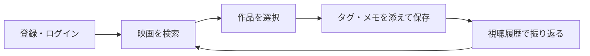
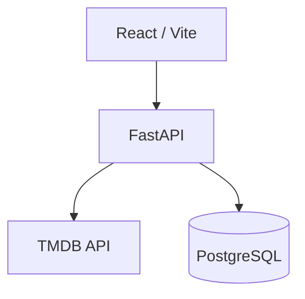

<div align="center">
  <h1>Film-like</h1>
  <p><strong>観た映画と、そのときの感想を残す映画日記。</strong></p>
  <p>作品を探し、タグとメモを添え、自分の視聴履歴を振り返る。</p>
  <p>🎬 <strong>映画検索</strong> · 🏷️ <strong>感想タグ</strong> · 📓 <strong>視聴履歴</strong></p>
</div>

<p align="center">
  <a href="https://film-like.vercel.app/"><strong>公開アプリ</strong></a> ·
  <a href="#development">開発・公開状況</a> ·
  <a href="#quickstart">はじめ方</a> ·
  <a href="#features">リポジトリで使える機能</a> ·
  <a href="#technology">技術構成</a> ·
  <a href="#verification">テスト</a>
</p>

---

<a id="development"></a>

## 開発・公開状況

| 項目 | 内容 |
| --- | --- |
| 開発開始 | 2026年4月 |
| 初期MVP完成 | 2026年6月 |
| 開発人数 | 3名 |
| 現在の状況 | 開発停止 |
| GitHubへの初回登録 | 2026年6月 |
| 公開アプリ | [Film-likeを開く](https://film-like.vercel.app/) |

初期MVPでは、アカウント登録、映画検索、視聴記録を実装しました。7月にGitHubのPRで検証したのは、気分に応じた推薦を加えた版です。[推薦機能のPR](https://github.com/zahin-dev/Film-like/pull/2) · [開発年月の訂正](docs/DevelopmentProcess.md#開発年月の訂正)

## 🎬 Film-likeとは

Film-likeは、観た作品とそのときの感想を作品ごとに残せるWebアプリです。TMDBで映画を検索し、自分の視聴記録にタグやメモを保存できます。

## ✨ なぜFilm-likeか

点数だけでは、何が心に残ったかを後から思い出しにくいことがあります。タグはそのときの感情を手早く残すために、メモは印象に残った場面や理由を書き留めるために使えます。

<a id="features"></a>

## 🎯 リポジトリで使える機能

| 機能 | 説明 |
| --- | --- |
| アカウント | ユーザー登録、ログイン、サインアウト |
| 映画検索・詳細 | TMDBでタイトル検索。詳細はAPIで取得 |
| 視聴履歴 | 記録の登録、一覧、削除 |
| 感想タグ・評価・メモ | 画面でタグとメモを入力。評価はAPIで設定 |

## 🔁 基本の流れ



## 🧱 アーキテクチャ

Reactの画面がFastAPIにリクエストし、FastAPIが映画情報をTMDBから取得します。ユーザー、視聴記録、タグはPostgreSQLに保存します。



[アーキテクチャ](docs/diagrams/Architecture.md) · [ER図](docs/diagrams/ERDiagram.md) · [シーケンス図](docs/diagrams/SequenceDiagrams.md)

<a id="technology"></a>

## 🛠 技術構成

| 領域 | 使用技術 |
| --- | --- |
| フロントエンド | React 19 / Vite |
| バックエンド | Python 3.12 / FastAPI / SQLAlchemy |
| データベース | PostgreSQL 16 / Alembic |
| 認証・外部連携 | JWT / TMDB API |
| ローカル開発 | Docker Compose（DB） / Uvicorn / Vite |

<a id="quickstart"></a>

## 🚀 はじめ方

### 前提条件

- Python 3.12
- Node.js 24
- Docker Compose
- TMDBの読み取り用アクセストークン（API設定の「API Read Access Token」）

### インストールと起動

リポジトリのルートで開発用PostgreSQLを起動します。

```powershell
docker compose up -d --wait
```

PostgreSQLは `127.0.0.1:55432` で起動します。新規の開発用DBを使います。

`backend` に移動し、Python 3.12の仮想環境を作成・有効化します。初回は `.env.example` を `.env` にコピーし、[環境変数](#environment)を設定します。

```powershell
python -m pip install -r requirements.txt
python -m alembic upgrade head
python -m seeds.seed_tag
python -m uvicorn app.main:app --host 127.0.0.1 --port 8000
```

別のターミナルで `frontend` に移動し、画面を起動します。

```powershell
npm ci
npm run dev -- --host 127.0.0.1
```

[Film-like](http://localhost:5173) · [Swagger UI](http://localhost:8000/docs)

Swagger UIの保護された操作には、`POST /auth/login` で取得したJWTを `Authorize` に入力します。

<a id="environment"></a>

## 🔐 環境変数

| 変数 | 設定内容 |
| --- | --- |
| `DATABASE_URL` | Composeで起動した開発用DBのURL。シェルに設定済みの場合も接続先を確認します。 |
| `SECRET_KEY` | ローカル用に生成したランダムなJWT署名キー。 |
| `TMDB_READ_ACCESS_TOKEN` | TMDBアカウントの読み取り用アクセストークン。 |

設定例は [バックエンドの環境変数サンプル](backend/.env.example) にあります。

## ☁️ Vercelで公開する

Vercelで同じリポジトリを2つのプロジェクトに分けて取り込みます。

| プロジェクト | ルートディレクトリ | プリセット | 本番環境変数 |
| --- | --- | --- | --- |
| API | `backend` | FastAPI | `DATABASE_URL`、`SECRET_KEY`、`TMDB_READ_ACCESS_TOKEN`、`FRONTEND_ORIGIN` |
| 画面 | `frontend` | Vite | `VITE_API_URL` |

Filmlike専用のPostgreSQLを用意し、公開前に `backend` から `python -m alembic upgrade head`、`python -m seeds.seed_tag` の順で実行します。`DATABASE_URL` はTLSを有効にした専用DBの接続URL、`SECRET_KEY` は本番用に生成したランダムな署名キーを使います。APIの `FRONTEND_ORIGIN` には画面の公開オリジン、画面の `VITE_API_URL` にはAPIの公開オリジンを、末尾のスラッシュなしで設定します。

## ⌨️ 主なコマンド

| 実行場所 | コマンド | 用途 |
| --- | --- | --- |
| ルート | `docker compose up -d --wait` | 開発用DBの起動 |
| `backend` | `python -m alembic upgrade head` | スキーマの適用 |
| `backend` | `python -m seeds.seed_tag` | 感想タグの投入 |
| `backend` | `python -m pytest -q --cov=app` | APIテストとカバレッジの計測 |
| `frontend` | `npm run dev` | フロントエンドの開発サーバー起動 |
| `frontend` | `npm run lint` / `npm run build` | ESLint検査とプロダクションビルド |

## 🗂 プロジェクト構成

```text
backend/
├── app/       # FastAPI、認証、映画検索、視聴記録
├── alembic/   # DBマイグレーション
├── seeds/     # 感想タグの初期データ
└── tests/     # バックエンドのテスト
frontend/
└── src/       # Reactの画面、認証状態、APIクライアント
docs/          # 設計資料
```

<a id="verification"></a>

## 🧪 テスト

バックエンドのテストは、インメモリSQLiteとTMDBのモックを使います。`backend` で実行します。

```powershell
python -m pytest -q --cov=app
```

フロントエンドの静的検査とビルドは、`frontend` で実行します。

```powershell
npm run lint
npm run build
```
