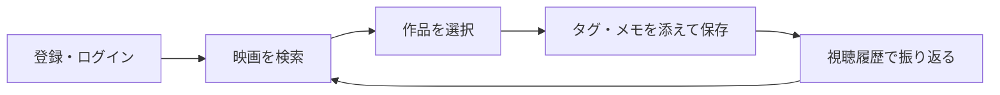
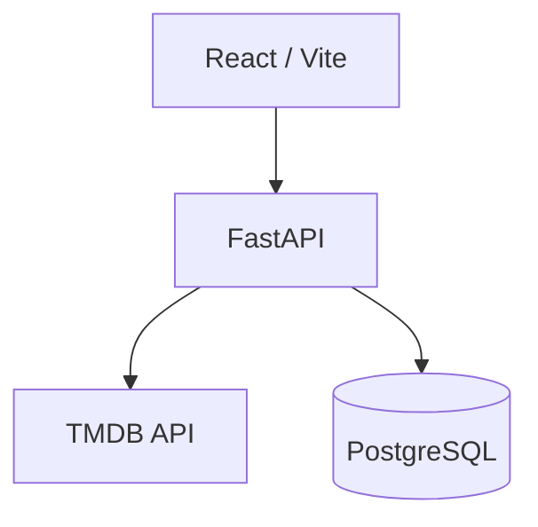

<div align="center">
  <h1>Film-like</h1>
  <p><strong>観た映画と、そのときの感想を残す映画日記。</strong></p>
  <p>作品を探し、タグとメモを添え、自分の視聴履歴を振り返る。</p>
  <p>🎬 <strong>映画検索</strong> · 🏷️ <strong>感想タグ</strong> · 📓 <strong>視聴履歴</strong></p>
</div>

## 🎬 Film-likeとは

Film-likeは、観た作品とそのときの感想を作品ごとに残せるWebアプリです。TMDBで映画を検索し、自分の視聴記録にタグやメモを保存できます。

チームの回顧では、3名で約3か月かけて初期MVPを共同開発しました。2025年8月末までのソースや日付付き一次資料は確認できておらず、当時の完成範囲は未確定です。現在の `main` は、2026年6月の最古の公開コードと7月のAPIスキーマ修復を基に、2026年11月に視聴記録の画面と検証環境を整えた再構成版です。GitHubリポジトリの作成日は2026年6月14日です。[チームの回顧](docs/DevelopmentProcess.md) · [最古の公開コード](https://github.com/zahin-dev/Film-like/commit/70a6e9e) · [スキーマ修復](https://github.com/zahin-dev/Film-like/commit/20569ae)

<a id="workflow"></a>

## 🖼 プレビュー

以下は2026年7月に開発された**日本語・ローカル版の参考画面**です。日本語UI、視聴傾向分析、ローカル推薦は、現在の `main` の収録範囲外です。[日本語ローカル化の記録](https://github.com/zahin-dev/Film-like/pull/5)

<table>
  <tr>
    <td colspan="2">
      
      <br /><sub><strong>ログイン</strong> — アカウントで映画日記を開く。</sub>
    </td>
  </tr>
  <tr>
    <td width="50%">
      
      <br /><sub><strong>映画日記の分析</strong> — 視聴件数と感想タグを振り返る。</sub>
    </td>
    <td width="50%">
      
      <br /><sub><strong>おすすめ</strong> — 今の気分に合う作品を探す。</sub>
    </td>
  </tr>
</table>

## ✨ なぜFilm-likeか

点数だけでは、何が心に残ったかを後から思い出しにくいことがあります。タグはそのときの感情を手早く残すために、メモは印象に残った場面や理由を書き留めるために使えます。

## 🎯 主な機能

| 機能 | 現在の `main` |
| --- | --- |
| アカウント | ユーザー登録、ログイン、サインアウト |
| 映画検索・詳細 | TMDBでタイトル検索。詳細はAPIで取得 |
| 視聴履歴 | 記録の登録、一覧、削除 |
| 感想タグ・評価・メモ | 画面でタグとメモを入力。評価はAPIで設定 |

推薦、視聴傾向分析、日本語ローカルカタログ、旧IDの互換移行、ポートフォリオ計測スクリプトは収録範囲外です。[推薦の記録](https://github.com/zahin-dev/Film-like/pull/2) · [視聴傾向分析と計測の記録](https://github.com/zahin-dev/Film-like/pull/3) · [日本語ローカル化の記録](https://github.com/zahin-dev/Film-like/pull/5)

## 🔁 基本の流れ



## 🧱 アーキテクチャ

Reactの画面がFastAPIにリクエストし、FastAPIが映画情報をTMDBから取得します。ユーザー、視聴記録、タグはPostgreSQLに保存します。



[アーキテクチャ](docs/diagrams/Architecture.md) · [ER図](docs/diagrams/ERDiagram.md) · [シーケンス図](docs/diagrams/SequenceDiagrams.md)

## 🛠 技術構成

| 領域 | 使用技術 |
| --- | --- |
| フロントエンド | React 19 / Vite |
| バックエンド | Python 3.12 / FastAPI / SQLAlchemy |
| データベース | PostgreSQL 16 / Alembic |
| 認証・外部連携 | JWT / TMDB API |
| ローカル開発 | Docker Compose（DB） / Uvicorn / Vite |

<a id="quickstart"></a>

## 🚀 はじめ方

### 前提条件

- Python 3.12
- Node.js 24
- Docker Compose
- TMDBのRead Access Token

### インストールと起動

リポジトリのルートで開発用PostgreSQLを起動します。

```powershell
docker compose up -d --wait
```

Composeプロジェクト `film-like-mvp-2025-scope` はPostgreSQLを `127.0.0.1:55432` で起動します。新規の開発用DBを使います。

`backend` に移動し、Python 3.12の仮想環境を作成・有効化します。初回は `.env.example` を `.env` にコピーし、[環境変数](#environment)を設定します。

```powershell
python -m pip install -r requirements.txt
python -m alembic upgrade head
python -m seeds.seed_tag
python -m uvicorn app.main:app --host 127.0.0.1 --port 8000
```

別のターミナルで `frontend` に移動し、画面を起動します。

```powershell
npm ci
npm run dev -- --host 127.0.0.1
```

[Film-like](http://localhost:5173) · [Swagger UI](http://localhost:8000/docs)

Swagger UIの保護された操作には、`POST /auth/login` で取得したJWTを `Authorize` に入力します。

<a id="environment"></a>

## 🔐 環境変数

| 変数 | 設定内容 |
| --- | --- |
| `DATABASE_URL` | Composeで起動した開発用DBのURL。シェルに設定済みの場合も接続先を確認します。 |
| `SECRET_KEY` | ローカル用に生成したランダムなJWT署名キー。 |
| `TMDB_READ_ACCESS_TOKEN` | TMDBアカウントのRead Access Token。 |

設定例は [バックエンドの環境変数サンプル](backend/.env.example) にあります。

## ⌨️ 主なコマンド

| 実行場所 | コマンド | 用途 |
| --- | --- | --- |
| ルート | `docker compose up -d --wait` | 開発用DBの起動 |
| `backend` | `python -m alembic upgrade head` | スキーマの適用 |
| `backend` | `python -m seeds.seed_tag` | 感想タグの投入 |
| `backend` | `python -m pytest -q --cov=app` | APIテストとカバレッジの計測 |
| `frontend` | `npm run dev` | フロントエンドの開発サーバー起動 |
| `frontend` | `npm run lint` / `npm run build` | ESLint検査とプロダクションビルド |

## 🗂 プロジェクト構成

```text
backend/
├── app/       # FastAPI、認証、映画検索、視聴記録
├── alembic/   # DBマイグレーション
├── seeds/     # 感想タグの初期データ
└── tests/     # バックエンドのテスト
frontend/
└── src/       # Reactの画面、認証状態、APIクライアント
docs/          # 設計資料、開発記録、参考画像
```

## 🧪 テストと検証

| 項目 | 2026年11月の再構成時の結果 |
| --- | --- |
| バックエンド | インメモリSQLiteとTMDBモックを使い、pytest 79件成功、カバレッジ91%。 |
| フロントエンド | `npm ci`、Lint、プロダクションビルドが成功。 |
| PostgreSQL | 新規DBにマイグレーション4件を適用し、タグ50件を投入。 |
| ブラウザ統合 | 登録、ログイン、映画検索、タグ・メモ付き記録、再読込後の表示、削除、サインアウトを確認。映画詳細APIも確認。TMDB応答はモック。 |
| Docker Compose | 設定検査に成功。再構成時はLinuxデーモンに接続できず、Compose経由の起動は未確認。 |
| TMDB実通信 | 有効なトークンを使った実通信は未確認。 |
| 依存関係監査 | npmが14件（高8件、中6件）を報告。開発依存を除いた結果は高2件。 |

日本語・ローカル版の記録は、[移行計画](docs/JapaneseOfflineMigrationPlan.md)・[インポート仕様](docs/FilmDataImport.md)・[当時の検証記録](docs/Verification.md)を参照してください。

## 👥 開発チーム

Film-likeは3名で共同開発したプロジェクトです。担当領域と協働の記録は [開発メンバー](CONTRIBUTORS.md) と [開発プロセス](docs/DevelopmentProcess.md) にまとめています。
