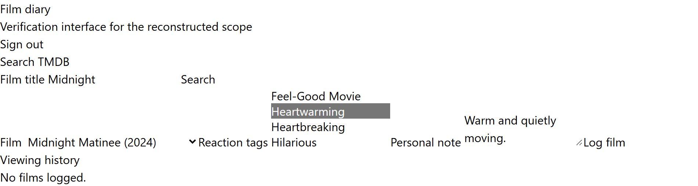
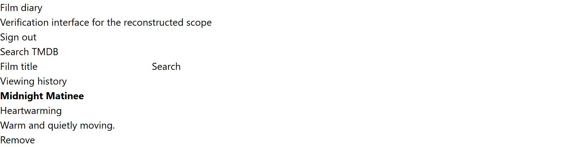
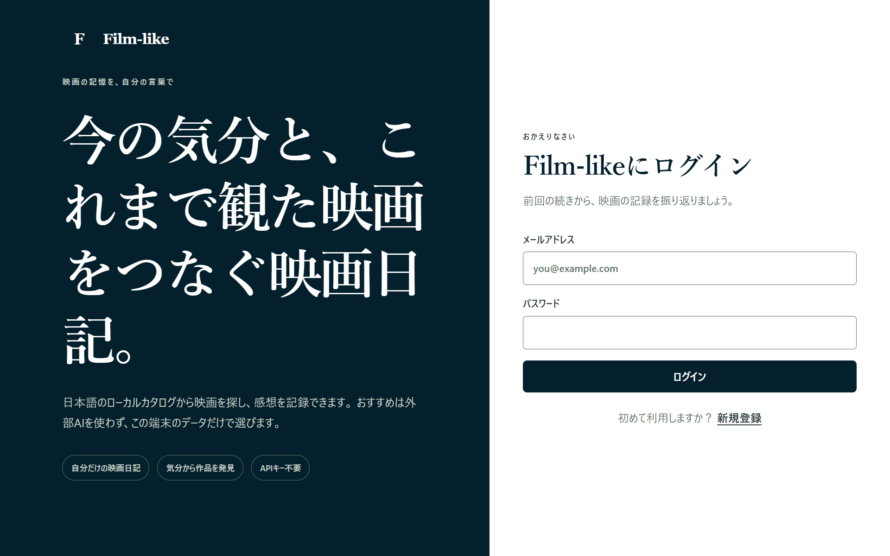
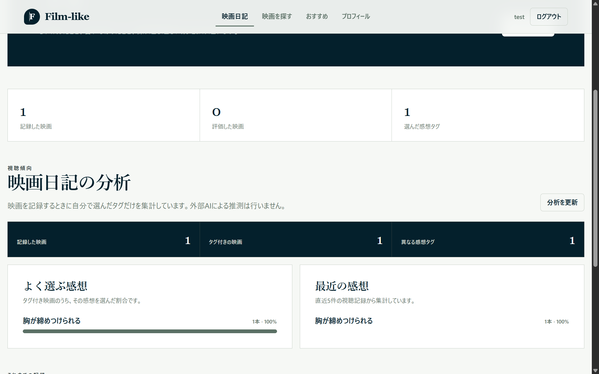
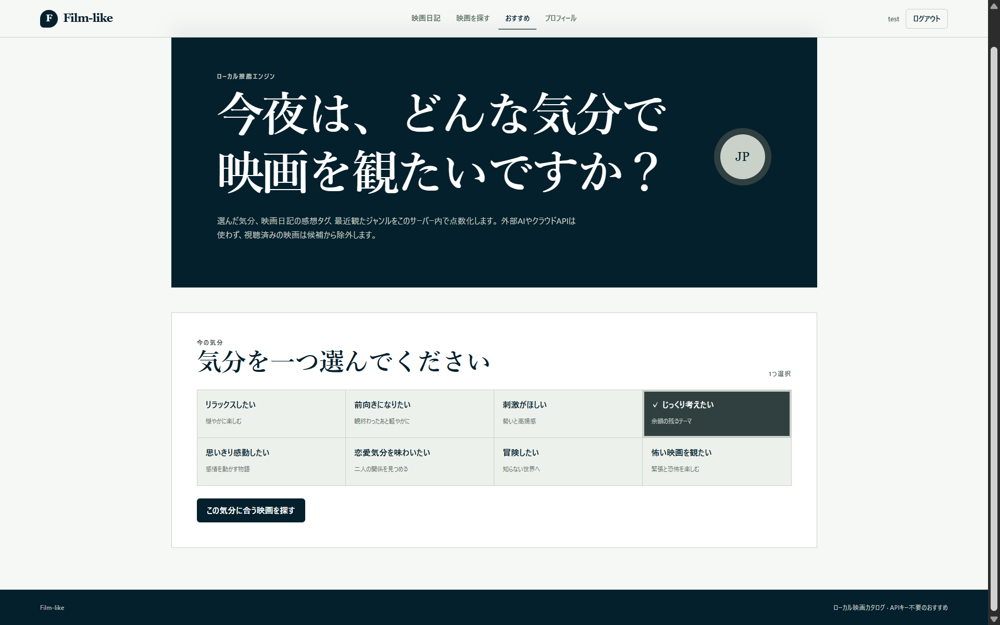

<h1 align="center">Film-like</h1>

<p align="center">
  <b>観た映画と、そのときの感想を残す映画日記。</b><br>
  作品を検索し、感想タグやメモと一緒に視聴記録を保存できます。
</p>

<p align="center">
  
  
  
  
</p>

<p align="center">
  <a href="#workflow">使用イメージ</a> ·
  <a href="#quickstart">クイックスタート</a> ·
  <a href="#features">主な機能</a> ·
  <a href="#technology">技術構成</a> ·
  <a href="#documentation">ドキュメント</a> ·
  <a href="#verification">検証</a>
</p>

---

Film-likeは、映画を観たときの気分や感想を作品ごとに振り返るためのWebアプリです。

チームの回顧では、3名で約3か月かけて初期MVPを共同開発しました。2025年8月末までのソースや日付付きの一次資料は確認できておらず、当時の完成範囲は未確定です。現行実装は、2026年6月の最古の公開コードと同年7月のAPIスキーマ修復を基に、2026年11月に視聴記録の画面と検証環境を整備した再構成版です。GitHub上のリポジトリは2026年6月14日に作成されました。[チームの回顧](docs/DevelopmentProcess.md) · [最古の公開コード](https://github.com/zahin-dev/Film-like/commit/70a6e9e) · [スキーマ修復](https://github.com/zahin-dev/Film-like/commit/20569ae)

<a id="workflow"></a>

## アプリの使用イメージ

現行の英語UIを、撮影用のサンプルデータで操作した画面です。映画検索にはTMDBの模擬応答を使用しています。

### 映画検索

ログイン後、映画のタイトルを入力して検索します。候補から観た作品を選び、感想タグやメモを添えて保存できます。



### 視聴履歴

保存した作品名、感想タグ、メモが視聴履歴に表示されます。不要になった記録は削除できます。



### 日本語・ローカル版の参考画面

以下は、2026年7月に開発された日本語・ローカル版を起動して撮影した画面です。日本語UI、視聴傾向分析、ローカル推薦は、現在の `main` の収録範囲外です。[日本語ローカル化の記録](https://github.com/zahin-dev/Film-like/pull/5)

#### ログイン



#### 映画日記の分析



#### 気分に合う映画のおすすめ



<a id="quickstart"></a>

## ⚡ クイックスタート

**Python 3.12**、**Node.js 24**、**Docker Compose**、**TMDBのRead Access Token**を用意します。

### データベースを起動する

リポジトリのルートで実行します。

```powershell
docker compose up -d --wait
```

専用のComposeプロジェクト `film-like-mvp-2025-scope` が、PostgreSQLを `127.0.0.1:55432` で起動します。初回セットアップには新規の開発用DBを使います。

### APIを起動する

`backend` でPython 3.12の仮想環境を作成・有効化します。初回は `.env.example` を `.env` にコピーし、次の値を設定します。

| 環境変数 | 設定内容 |
| :--- | :--- |
| `DATABASE_URL` | Composeで起動した開発用PostgreSQLのURL。シェルですでに設定している場合は、この開発用DBを指すことを確認してください。 |
| `SECRET_KEY` | ローカル用に生成したランダムなJWT署名キー。 |
| `TMDB_READ_ACCESS_TOKEN` | TMDBアカウントのRead Access Token。 |

```powershell
python -m pip install -r requirements.txt
python -m alembic upgrade head
python -m seeds.seed_tag
python -m uvicorn app.main:app --host 127.0.0.1 --port 8000
```

### 画面を起動する

別のターミナルで `frontend` に移動し、実行します。

```powershell
npm ci
npm run dev -- --host 127.0.0.1
```

画面は [localhost:5173](http://localhost:5173)、API仕様と操作画面は [Swagger UI](http://localhost:8000/docs) で開けます。Swagger UIの保護された操作には、`POST /auth/login` で取得したJWTを `Authorize` に入力します。

<a id="features"></a>

## 🎯 主な機能

- **アカウント** — ユーザー登録、ログイン、サインアウト。
- **映画検索・詳細** — TMDBの作品をタイトルで検索。映画の詳細はAPIから取得できます。
- **視聴記録** — アカウントごとに映画を登録・一覧表示・削除。
- **感想タグ・評価・メモ** — 画面でタグとメモを登録。評価はAPIから設定できます。

### 収録範囲

映画日記に範囲を絞っています。2026年7月に追加された推薦・視聴傾向分析、日本語ローカルカタログと外部APIを使わない構成、旧IDの互換移行、ポートフォリオ計測スクリプトは収録範囲外です。[推薦](https://github.com/zahin-dev/Film-like/pull/2) · [視聴傾向分析と計測](https://github.com/zahin-dev/Film-like/pull/3) · [日本語ローカル化](https://github.com/zahin-dev/Film-like/pull/5)

<a id="technology"></a>

## 🧩 技術構成

| 領域 | 使用技術 |
| :--- | :--- |
| バックエンド | Python 3.12 / FastAPI / SQLAlchemy |
| フロントエンド | React 19 / Vite |
| データベース | PostgreSQL 16 / Alembic |
| 認証・外部連携 | JWT / TMDB API |
| ローカル開発 | Docker Compose（DB） / Uvicorn / Vite |

<a id="documentation"></a>

## 📚 ドキュメント

| 分類 | 資料 |
| :--- | :--- |
| チーム・経緯 | [開発メンバー](CONTRIBUTORS.md) · [開発プロセス](docs/DevelopmentProcess.md) |
| 技術設計 | [アーキテクチャ](docs/diagrams/Architecture.md) · [ER図](docs/diagrams/ERDiagram.md) · [シーケンス図](docs/diagrams/SequenceDiagrams.md) |
| 2026年7月の日本語ローカル版の記録 | [移行計画](docs/JapaneseOfflineMigrationPlan.md) · [インポート仕様](docs/FilmDataImport.md) · [当時の検証記録](docs/Verification.md) |

<a id="verification"></a>

## 🧪 検証

`backend` で次を実行します。テストはインメモリSQLiteとTMDBのモックを使用します。

```powershell
python -m pytest -q --cov=app
```

`frontend` で次を実行します。

```powershell
npm run lint
npm run build
```

| 項目 | 2026年11月の再構成時の結果 |
| :--- | :--- |
| バックエンド | pytest 79件成功、カバレッジ91%。 |
| フロントエンド | `npm ci`、Lint、プロダクションビルドが成功。 |
| PostgreSQL | 新規のPostgreSQL 16にAlembicマイグレーション4件を適用し、タグ50件を投入。 |
| ブラウザ統合 | React・FastAPI・新規PostgreSQLを接続し、登録、ログイン、映画検索、タグ・メモ付き記録、再読込後の表示、削除、サインアウトを確認。映画詳細APIも確認。TMDB応答はモック。 |
| Docker Compose | 設定検査に成功。Linuxデーモンに接続できず、Compose経由の起動は未確認。 |
| TMDB実通信 | 有効なトークンを使った実通信は未確認。 |
| 依存関係監査 | npmが14件（高8件、中6件）を報告。開発依存を除いた結果は高2件。 |
